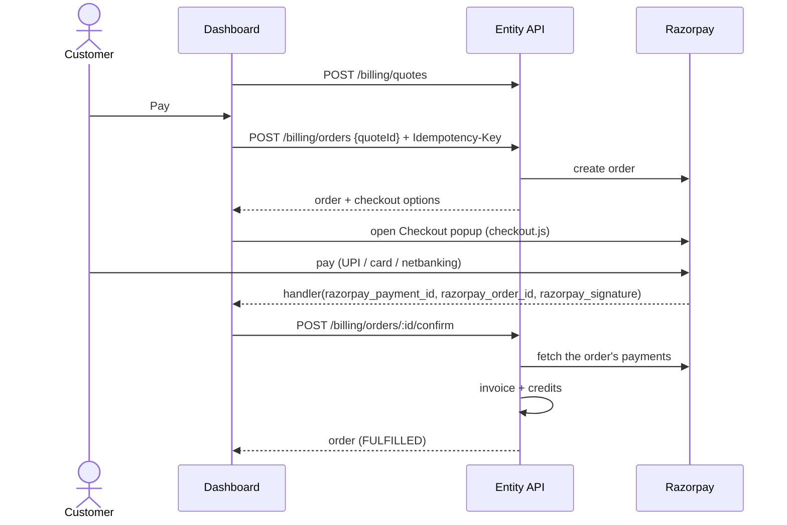

# Billing API contract (for dashboard integration)

The request and response formats for the billing APIs in `entity-developer-dashboard-service`. The dashboard can be built and mocked against this document while the backend is implemented. The design behind it is in [credits-top-up-payment.md](credits-top-up-payment.md) (the ADR, "§" below), and the delivery order is in [epics.md](epics.md).

| Part | Status | Build the UI now? |
|---|---|---|
| [Stage 1: invoicing](#stage-1-invoicing) | **Agreed** | Yes |
| [Stage 2: payments](#stage-2-payments) | **Agreed** for India with Razorpay: §6 checkout, §7 Collect payment (payment links) | Yes, behind `features.pay` (customer) and the Razorpay keys (super admin) |

Any change to an agreed endpoint is recorded in the [changelog](#changelog) at the end.

---

## 1. Conventions

### 1.1 Base URL and authentication

- **Base URL:** the dashboard service's existing URL. Every path below starts with `/api/v1`.
- **Authentication:** the same as every other dashboard call. The session is in the `accessToken` cookie, so send requests with credentials (`withCredentials: true` in axios, `credentials: 'include'` in fetch). Don't send an `Authorization` header.
- **Team members:** they call the same endpoints. The server maps them to the account owner's organisation.
- **Permissions:**
  - customer reads need `READ_BILLING`;
  - customer writes need `WRITE_BILLING`;
  - `/admin/...` endpoints need a super-admin session.

  The account owner has both billing permissions automatically.

### 1.2 Headers

| Header | When | Value |
|---|---|---|
| `Content-Type` | Requests with a body | `application/json` |
| `Idempotency-Key` | `POST /admin/billing/invoices`, `POST /billing/orders` | A new UUID v4 for each user action. Reuse the **same** key when retrying the same action after a network error or a double click. |

### 1.3 Money, percentages, dates and ids

- **Money is always an integer in minor units** (paise or cents), in a field ending in `Minor`. The `currency` field sits next to it.
  - Display rule: divide by 100 and format with `Intl.NumberFormat`: `en-IN` for `INR`, `en-US` for `USD`, always 2 decimals. For example, `172431` with `INR` is `₹1,724.31`.
- **Percentages are integer basis points**, in fields ending in `Bps`. For example, `4650` is 46.5%. Display rule: `bps / 100` followed by `%`.
- **Never calculate an amount in the UI.** Show what the server returns. Even custom-amount totals come from a quote (§3.3).
- **Dates** are ISO 8601 strings in UTC, like `"2026-10-31T10:15:00.000Z"`. Show them in the user's local time.
- **Ids** are strings.

### 1.4 Enums

| Name | Values |
|---|---|
| `Region` | `IN`, `GLOBAL` |
| `Currency` | `INR` (with `IN`), `USD` (with `GLOBAL`) |
| `InvoiceStatus` | `UNPAID`, `PAID`, `VOID` |
| `InvoiceSettlement` | `COMPLIMENTARY`, `OFFLINE`, `GATEWAY` (only on `PAID` invoices) |
| `InvoiceSource` | `SELF_SERVE`, `ADMIN` |
| `OrderStatus` | `CREATED`, `PENDING_PAYMENT`, `PAID`, `FULFILLED`, `FAILED`, `EXPIRED`, `CANCELLED`, `NEEDS_REVIEW` |
| `OfflinePaymentMethod` | `BANK_TRANSFER`, `UPI`, `CHEQUE`, `CARD_OUTSIDE_DASHBOARD`, `OTHER_SYSTEM` |
| `TaxLineType` | `CGST`, `SGST`, `IGST`, `GST` (Indian state not known yet), `ZERO_RATED_EXPORT`, `VAT`, `SALES_TAX` |
| `TaxMode` | `INCLUDED_IN_QUOTE` (India: the quote contains the final GST), `NONE` (Global: no tax is charged), `CALCULATED_AT_CHECKOUT` (reserved: not returned today) |

### 1.5 Errors

Errors use the service's existing format, `statusCode`, `message` (always an array) and `error`, plus two fields added for billing: a machine-readable `code` and an optional `details`. Other endpoints in this service return only `statusCode`, `message` and `error`, so a shared error handler must not assume `code` is present.

```json
{
  "statusCode": 422,
  "error": "Unprocessable Entity",
  "code": "COUPON_INVALID",
  "message": ["This coupon code is not valid."],
  "details": {}
}
```

- **Branch on `code`,** never on `message`.
- **`message[0]`** is safe to show to the user unless an endpoint says otherwise.
- **`details`** is optional. Its shape depends on the `code`, and each case is described below.

Codes shared by all endpoints:

| HTTP | `code` | Meaning | UI behaviour |
|---|---|---|---|
| 400 | `VALIDATION_FAILED` | The request body or query is invalid. `details.fields` holds an object of field name → message | Show the messages next to the fields |
| 401 | (no code, existing behaviour) | Not logged in, or the session expired | The existing logout flow |
| 403 | (no code, existing behaviour) | Missing `READ_BILLING` / `WRITE_BILLING`, or not a super admin | Hide or disable the feature |
| 404 | `APP_NOT_FOUND` | The app doesn't exist or isn't in the caller's organisation | — |
| 422 | `APP_NOT_BILLABLE` | The app isn't an ID Service (`CAVACH_API`) app | — |
| 429 | (no code, existing behaviour) | Too many requests | "Please try again in a moment" |
| 503 | `BILLING_DISABLED` | Billing is switched off for this region | Hide top-up and billing features |

### 1.6 Paginated lists

List endpoints take `page` (default 1) and `limit` (default 10, at most 100). They return:

```json
{ "data": [], "page": 1, "limit": 10, "total": 0 }
```

---

## Stage 1: invoicing

### 2. Billing profile

The company details printed on invoices. They are stored on the organisation's onboarding record and prefilled from onboarding and KYB (§4.1).

#### `BillingProfile` object

```json
{
  "orgId": "69832fafec5bf58b25caff2b",
  "legalName": "Acme Technologies Private Limited",
  "email": "billing@acme.example",
  "phone": "+919876543210",
  "address": {
    "street": "12 MG Road",
    "city": "Bengaluru",
    "province": "Karnataka",
    "postalCode": "560001",
    "country": "IN"
  },
  "gstStateCode": "29",
  "taxIds": [{ "type": "GSTIN", "number": "29ABCDE1234F1Z5" }],
  "region": "IN",
  "currency": "INR",
  "source": "SAVED",
  "complete": true,
  "missingFields": [],
  "locked": false,
  "lockedAt": null
}
```

| Field | Notes |
|---|---|
| `phone` | International form, stored without spaces (`+493012345678`); `null` if not given. Optional, and not part of `complete`, but **Global customers need it to pay online** (Razorpay asks for it on international payments): checkout and payment links answer `422 BILLING_PROFILE_INCOMPLETE` with `missingFields: ["phone"]` without it |
| `address.country` | ISO 3166-1 alpha-2 code |
| `gstStateCode` | India only, 2 digits. Taken from a GSTIN first, then from the `gstStateCode` sent, then from `address.province` when it is a state name ("West Bengal", "WEST BENGAL", "Jammu & Kashmir"; not abbreviations). The UI's State / province field is a state dropdown for India, which sends both the name and the code |
| `taxIds[].type` | `GSTIN`, `PAN`, `VAT`, … (the existing `TaxIdTypes`). The server validates the number against the type |
| `personalTaxId` | `{ "type": "PAN" \| "OTHER", "number": "XXXXXX234F" }` or `null`. Read-only: from KYB when the business isn't registered for tax. Only the last 4 characters are stored. Don't send it in `PUT`, and don't add it to `taxIds`. Invoices print it masked when the profile has no `taxIds` |
| `region`, `currency` | Read-only. Set by the server from `address.country` on each save (`IN` → `IN`/`INR`, anything else → `GLOBAL`/`USD`). Once `locked`, only a super admin can change them |
| `source` | `PREFILLED`: never saved, so the values are suggestions; show the form for confirmation. `SAVED`: the customer has confirmed them, or KYB approval saved complete prefilled details |
| `complete` | `true` only when nothing is missing **and** the profile is saved (`source: "SAVED"`). `false` means invoices can't be issued yet. `missingFields` lists the missing fields, using the same paths as above, for example `"address.postalCode"` or `"gstStateCode"`; it can be empty while `source` is still `PREFILLED`, in which case the form only needs confirming |
| `locked` | `true` after the first invoice (paid, offline or the ₹0 promotion invoice). The tax IDs, and an address country in another region, can't be changed any more; show them read-only, with "Contact support to change" |

#### `GET /api/v1/customer-onboarding/billing`

Returns the caller's organisation's profile, prefilled if it was never saved. Needs `READ_BILLING`.

- **200:** `BillingProfile`
- **404 `ONBOARDING_NOT_FOUND`:** the account hasn't onboarded. Send the user to onboarding.

#### `PUT /api/v1/customer-onboarding/billing`

Saves the profile. Needs `WRITE_BILLING`.

```json
{
  "legalName": "Acme Technologies Private Limited",
  "email": "billing@acme.example",
  "phone": "+91 98765 43210",
  "address": { "street": "12 MG Road", "city": "Bengaluru", "province": "Karnataka", "postalCode": "560001", "country": "IN" },
  "gstStateCode": "29",
  "taxIds": [{ "type": "GSTIN", "number": "29ABCDE1234F1Z5" }]
}
```

- **200:** the saved `BillingProfile`, with `source: "SAVED"`.
- **400 `VALIDATION_FAILED`:** for example, an invalid GSTIN appears as `details.fields["taxIds[0].number"]`, and a phone without its country code as `details.fields.phone`.
- `phone` must start with `+` and the country code; spaces and dashes are fine. This is a full save: leaving `phone` out (or `""`) removes a saved one, so always send the current value.
- **400 `VALIDATION_FAILED`** also covers a GSTIN with an address outside India: `details.fields["taxIds[0].number"]`.
- **409 `BILLING_PROFILE_LOCKED`:** the request changed the tax IDs of a locked profile, or moved its address to a country in another region.
- **409 `REGION_CHANGE_BLOCKED`:** the new address country changes the region while an order is still open (not yet paid, or paid and not yet invoiced). `details.orders` lists their order numbers. Ask the customer to finish or cancel them first. Super admins get it too.

---

### 3. Top-up popup

#### 3.1 `GET /api/v1/billing/catalog`

The published prices for the caller's region. Replaces `creditTopUpPricing.js`. Needs `READ_BILLING`.

**200:**

```json
{
  "priceBookId": "6723a1f0c1d2e3f4a5b6c7d8",
  "version": 1,
  "region": "IN",
  "currency": "INR",
  "creditsPerMajorUnit": 1,
  "validityDays": 30,
  "taxMode": "INCLUDED_IN_QUOTE",
  "features": { "coupons": true, "pay": false },
  "plans": [
    { "code": "IN_999",  "priceMinor": 99900,  "discountBps": 1000, "discountMinor": 9990,   "totalBeforeTaxMinor": 89910,  "credits": 999,  "displayOrder": 1 },
    { "code": "IN_2499", "priceMinor": 249900, "discountBps": 2500, "discountMinor": 62475,  "totalBeforeTaxMinor": 187425, "credits": 2499, "displayOrder": 2 },
    { "code": "IN_4999", "priceMinor": 499900, "discountBps": 2800, "discountMinor": 139972, "totalBeforeTaxMinor": 359928, "credits": 4999, "displayOrder": 3 },
    { "code": "IN_9999", "priceMinor": 999900, "discountBps": 3500, "discountMinor": 349965, "totalBeforeTaxMinor": 649935, "credits": 9999, "displayOrder": 4 }
  ],
  "custom": {
    "enabled": true,
    "minMinor": 99900,
    "maxMinor": 999900,
    "discountRanges": [
      { "minMinor": 99900,  "maxMinor": 249899, "discountBps": 1000 },
      { "minMinor": 249900, "maxMinor": 499899, "discountBps": 2500 },
      { "minMinor": 499900, "maxMinor": 999899, "discountBps": 2800 },
      { "minMinor": 999900, "maxMinor": 999900, "discountBps": 3500 }
    ]
  },
  "addOns": [
    { "code": "VALIDITY", "title": "Credit validity", "shortTitle": "1 month validity", "description": "Credits are valid for 1 month from activation. Unused credits don't carry forward.", "icon": "mdi-calendar-clock", "priceMinor": 0, "included": true },
    { "code": "HUMAN_SUPPORT_24X7", "title": "24×7 human support", "shortTitle": "24×7 support", "description": "…", "icon": "mdi-headset", "priceMinor": 0, "included": true },
    { "code": "EMAIL_SUPPORT", "title": "Email support", "shortTitle": "Email support", "description": "…", "icon": "mdi-email-outline", "priceMinor": 0, "included": true }
  ],
  "calculatorFlowIds": ["india"]
}
```

| Field | Notes |
|---|---|
| `plans` | Sort by `displayOrder`. The discount and total are already worked out, so show them as they are. The total excludes tax |
| `custom.discountRanges` | Only for showing a "25% off" hint while the user types a custom amount. Amounts still come from a quote |
| `custom` amounts | Must be whole major units (a multiple of 100 minor units) between `minMinor` and `maxMinor` |
| `taxMode` | `INCLUDED_IN_QUOTE`: show the GST line(s) from the quote. `NONE`: show no tax line and no "+ tax"; the total is final. `CALCULATED_AT_CHECKOUT` isn't returned today; if it ever is, show "Tax is calculated on the secure payment page" |
| `features.pay` | `false` during stage 1. Show the Pay button disabled, for example with a "Coming soon" tooltip |
| `features.coupons` | `false` hides "Apply coupon" |
| `addOns` | `priceMinor: 0` displays as "Free". `included: true` means there is no checkbox |
| `calculatorFlowIds` | Pass these to the Credit Calculator in place of the "Preview as" switch |

**A Global account gets the same shape:** `region: "GLOBAL"`, `currency: "USD"`, `creditsPerMajorUnit: 90`, `validityDays: 180`, `taxMode: "NONE"` and `calculatorFlowIds: ["global", "business"]`. The plans are:

| `code` | `priceMinor` | `discountBps` | `discountMinor` | `totalBeforeTaxMinor` | `credits` |
|---|---|---|---|---|---|
| `GL_99` | 9900 | 0 | 0 | 9900 | 8910 |
| `GL_199` | 19900 | 4000 | 7960 | 11940 | 17910 |
| `GL_299` | 29900 | 4650 | 13904 | 15996 | 26910 |
| `GL_499` | 49900 | 5200 | 25948 | 23952 | 44910 |
| `GL_1499` | 149900 | 5500 | 82445 | 67455 | 134910 |

#### 3.2 `GET /api/v1/billing/coupons?appId=…&planCode=…` or `…&customAmountMinor=…`

The listed coupons the account can use right now. Feeds the **Apply a coupon** dialog. Needs `READ_BILLING`. `planCode` and `customAmountMinor` are optional; without them, `previewDiscountMinor` is `null`.

**200:**

```json
{
  "coupons": [
    {
      "code": "FOUNDING8",
      "title": "Founding customer offer",
      "description": "8% off your first 3 top-ups within 6 months of KYB approval.",
      "percentBps": 800,
      "maxDiscountMinor": null,
      "previewDiscountMinor": 14994,
      "usesLeft": 3,
      "expiresAt": "2027-04-12T00:00:00.000Z"
    }
  ]
}
```

- **An empty list** means no offers. Show the code input only.
- **`previewDiscountMinor`** feeds the "Saves ₹149.94 on this top-up" line.
- **Picking a coupon from the list** or typing a code doesn't apply it. Applying means requesting a new quote with `couponCode` (§3.3).

#### 3.3 `POST /api/v1/billing/quotes`

Prices the current selection. Request a new quote every time the plan, the custom amount or the coupon changes. Debounce custom-amount typing by about 400 ms. Needs `READ_BILLING`. Rate-limited.

**Request:** exactly one of `planCode` and `customAmountMinor`.

```json
{ "appId": "98f0815cf8c2096a2b54ea1746f5b9538a72", "planCode": "IN_2499", "couponCode": "FOUNDING8" }
```

```json
{ "appId": "98f0815cf8c2096a2b54ea1746f5b9538a72", "customAmountMinor": 320000 }
```

**200, India:**

```json
{
  "quoteId": "6723b0a1c1d2e3f4a5b6c7e9",
  "appId": "98f0815cf8c2096a2b54ea1746f5b9538a72",
  "region": "IN",
  "currency": "INR",
  "priceBookVersion": 1,
  "selection": { "planCode": "IN_2499", "customAmountMinor": null, "couponCode": "FOUNDING8" },
  "subtotalMinor": 249900,
  "planDiscount": { "percentBps": 2500, "amountMinor": 62475 },
  "coupon": { "code": "FOUNDING8", "percentBps": 800, "amountMinor": 14994 },
  "addOns": [
    { "code": "VALIDITY", "title": "Credit validity", "priceMinor": 0 },
    { "code": "HUMAN_SUPPORT_24X7", "title": "24×7 human support", "priceMinor": 0 },
    { "code": "EMAIL_SUPPORT", "title": "Email support", "priceMinor": 0 }
  ],
  "totalBeforeTaxMinor": 172431,
  "tax": {
    "mode": "INCLUDED_IN_QUOTE",
    "amountMinor": 31038,
    "lines": [{ "type": "IGST", "rateBps": 1800, "amountMinor": 31038 }]
  },
  "totalMinor": 203469,
  "credits": 2499,
  "validityDays": 30,
  "billingProfileComplete": true,
  "expiresAt": "2026-10-31T10:15:00.000Z"
}
```

**200, Global,** with `planCode: "GL_299"` and `couponCode: "FOUNDING15"`. These fields differ from the India example:

```json
{
  "region": "GLOBAL",
  "currency": "USD",
  "subtotalMinor": 29900,
  "planDiscount": { "percentBps": 4650, "amountMinor": 13904 },
  "coupon": { "code": "FOUNDING15", "percentBps": 1500, "amountMinor": 2399 },
  "totalBeforeTaxMinor": 13597,
  "tax": { "mode": "NONE", "amountMinor": 0, "lines": [] },
  "totalMinor": 13597,
  "credits": 26910,
  "validityDays": 180
}
```

| Field | Notes |
|---|---|
| `coupon` | `null` when there's no coupon |
| `tax.lines` | Show one row per line: "IGST (18%)", or "CGST (9%)" and "SGST (9%)". Type `GST` means the customer's state isn't known yet, which is also signalled by `billingProfileComplete: false` |
| `totalMinor` | `totalBeforeTaxMinor` plus `tax.amountMinor`: the final amount in both regions. Global charges no tax, so it equals `totalBeforeTaxMinor` |
| `billingProfileComplete` | `false`: show the billing details form before Pay (stage 2) |
| `expiresAt` | 15 minutes. Request a new quote when the popup is reopened, or before Pay if it has expired |
| `quoteId` | Kept for Pay in stage 2 (§6.1) |

**Errors:**

| HTTP | `code` | UI behaviour |
|---|---|---|
| 422 | `COUPON_INVALID` | Show "This coupon code is not valid." under the coupon field, remove the coupon, and request the quote again without it. Every rejected code gets this same response, whatever the reason |
| 429 | `RATE_LIMITED` | After 10 rejected coupon codes in 10 minutes, the account can't try more codes for a while. Show "Too many coupon attempts. Please try again later." and quote without the coupon. Quotes without a coupon still work. This 429 **does** carry a `code`, unlike the shared rate limiter's |
| 422 | `AMOUNT_OUT_OF_RANGE` | Under the custom amount, show the allowed range from `custom.minMinor` and `custom.maxMinor` and "For larger amounts, talk to sales". `details`: `{ "minMinor": 99900, "maxMinor": 999900 }` |
| 422 | `PLAN_NOT_FOUND` | The plan isn't in the published price book any more. Reload the catalog |

---

### 4. Invoices: customer

#### `InvoiceSummary` object

```json
{
  "invoiceId": "6723c4d2c1d2e3f4a5b6c7f0",
  "invoiceNumber": "HS/IN/2026-27/000123",
  "source": "ADMIN",
  "status": "PAID",
  "settlement": "OFFLINE",
  "appId": "98f0815cf8c2096a2b54ea1746f5b9538a72",
  "appName": "Acme KYC",
  "issuedAt": "2026-10-31T09:00:00.000Z",
  "paidAt": "2026-10-30T00:00:00.000Z",
  "dueAt": null,
  "currency": "INR",
  "totalMinor": 4720000,
  "amountPaidMinor": 4720000,
  "balanceDueMinor": 0,
  "credits": 40000,
  "validityDays": 30,
  "creditPlanId": "6723c4d9c1d2e3f4a5b6c7f1",
  "payment": { "method": "BANK_TRANSFER", "reference": "UTR0012345678", "provider": null },
  "payNowUrl": null
}
```

| Field | Notes |
|---|---|
| `status` / `settlement` | Tag and settlement text in Credit Purchase History: `PAID` + `GATEWAY` is "Paid · Paid via {payment.method}"; `PAID` + `OFFLINE` is "Paid · Paid offline"; `PAID` + `COMPLIMENTARY` is "Complimentary · No payment due"; `VOID` is "Void". `UNPAID` isn't issued: Collect payment issues the invoice only once paid (§7) |
| `creditPlanId` | Joins the invoice to a credit plan from the existing `GET /api/v1/app/:appId/credits` (the plan's `_id`). `null` for unpaid or void invoices, which have no plan yet |
| `payNowUrl` | Always `null` today. Open payment links come from `GET /billing/payment-links` (§7) |

#### `GET /api/v1/billing/invoices?appId=…&status=…&page=…&limit=…`

The organisation's invoices, newest first. Needs `READ_BILLING`. `appId` and `status` are optional filters.

- **200:** a paginated list of `InvoiceSummary`.

**How Credit Purchase History uses it:** load the app's credit plans as today, plus `GET /billing/invoices?appId=…`. Then:
- put each invoice in the **Invoice** column of the plan whose `_id` equals its `creditPlanId`;
- add the open payment links from `GET /billing/payment-links?appId=…` (§7), which have no plan or invoice yet, as "Awaiting payment" rows with **Pay now**;
- sort all rows by date.

#### `InvoiceDocument` object

Everything printed on the invoice, copied in when it was issued and never changed afterwards. The dashboard renders the PDF from it (ADR §8.3); nothing is stored as a file.

India, **Already paid**, customer in Maharashtra:

```json
{
  "invoiceId": "6723c4d2c1d2e3f4a5b6c7f0",
  "invoiceNumber": "HS/IN/2026-27/000123",
  "templateVersion": "invoice-v1",
  "series": "IN",
  "financialYear": "2026-27",
  "source": "ADMIN",
  "status": "PAID",
  "settlement": "OFFLINE",
  "issuedAt": "2026-11-01T09:00:00.000Z",
  "paidAt": "2026-10-30T00:00:00.000Z",
  "dueAt": null,
  "currency": "INR",
  "supplier": {
    "legalName": "Hypermine Technologies Private Limited",
    "email": "billing@hypersign.id",
    "address": { "street": "1st Floor, 12 MG Road", "city": "Bengaluru", "province": "Karnataka", "postalCode": "560001", "country": "IN" },
    "gstin": "29AAAAA0000A1Z5",
    "pan": "AAAAA0000A",
    "cin": null,
    "lutArn": null
  },
  "customer": {
    "legalName": "Acme Technologies Private Limited",
    "email": "billing@acme.example",
    "address": { "street": "4 Linking Road", "city": "Mumbai", "province": "Maharashtra", "postalCode": "400050", "country": "IN" },
    "taxIds": [{ "type": "GSTIN", "number": "27ABCDE1234F1Z5" }],
    "gstStateCode": "27"
  },
  "placeOfSupply": { "code": "27", "name": "Maharashtra" },
  "app": { "appId": "98f0815cf8c2096a2b54ea1746f5b9538a72", "appName": "Acme KYC" },
  "orderNumber": null,
  "lines": [
    { "description": "Prepaid identity verification credits", "sac": "998314", "quantity": 1, "unitPriceMinor": 4000000, "discountMinor": 0, "taxableMinor": 4000000 }
  ],
  "addOnLines": [
    { "code": "VALIDITY", "title": "Credit validity" },
    { "code": "HUMAN_SUPPORT_24X7", "title": "24×7 human support" },
    { "code": "EMAIL_SUPPORT", "title": "Email support" }
  ],
  "discounts": { "plan": null, "coupon": null },
  "tax": [{ "type": "IGST", "rateBps": 1800, "amountMinor": 720000 }],
  "taxNote": "Tax is payable on reverse charge: No.",
  "totals": {
    "subtotalMinor": 4000000,
    "discountMinor": 0,
    "taxableMinor": 4000000,
    "taxMinor": 720000,
    "totalMinor": 4720000,
    "amountPaidMinor": 4720000,
    "balanceDueMinor": 0
  },
  "credits": 40000,
  "validityDays": 30,
  "payment": { "method": "BANK_TRANSFER", "reference": "UTR0012345678", "provider": null, "paymentId": null, "paidAt": "2026-10-30T00:00:00.000Z" },
  "payNowUrl": null,
  "fx": null,
  "voidedAt": null,
  "voidReason": null
}
```

How other invoices differ:

| Invoice | Differences |
|---|---|
| **Complimentary** (Free credits) | `settlement: "COMPLIMENTARY"`, `lines[0].unitPriceMinor: 0`, `tax: []`, every `totals` field `0`, `payment: null` |
| **Customer in Karnataka** (our state) | `tax`: CGST 9% and SGST 9% lines |
| **Global** | `series: "GL"`, `financialYear: null`, `currency: "USD"`, `tax: []`, `customer.gstStateCode: null`, `placeOfSupply: { "code": "96", "name": "Other Countries" }`, `taxNote`: "Supply meant for export of services under LUT without payment of IGST." |
| **Self-serve** (stage 2) | `source: "SELF_SERVE"`, `settlement: "GATEWAY"`, `orderNumber` set, `discounts.plan` / `discounts.coupon` filled, `payment.provider` and `payment.paymentId` set |
| **Collect payment, paid** | `source: "ADMIN"`, `settlement: "GATEWAY"`, `orderNumber` set, `payment.provider: "razorpay"`, `payment.paymentId` and `payment.method` set |

Rendering rules:
- **Pick the template by `templateVersion`.** Keep every version the dashboard has ever shipped. If the version is unknown, show "Please refresh the dashboard to download this invoice" instead of rendering with another template.
- **Print only what's in the object.** Don't recompute amounts or look up current company or customer details; they may have changed since the invoice was issued.
- **Derived text** (amount in words, date formats, badge labels) is part of the template version: don't change it for an existing version.
- **`taxNote`, `placeOfSupply`, `supplier.cin` and `supplier.lutArn`:** print them when not `null`.
- **The line's sub-text** ("40,000 credits · valid 30 days · Acme KYC") comes from `credits`, `validityDays` and `app.appName`.
- **File name:** the invoice number with `/` replaced by `-`, for example `HS-IN-2026-27-000123.pdf`.

`fx` (USD invoices paid online): the INR value at the rate Razorpay converted the payment at, for GST and export reporting. `null` for INR invoices, and for USD invoices not paid through Razorpay.

```json
"fx": { "inrPerUnit": 84.05, "totalInrMinor": 1003557, "rateDate": "2026-11-05T10:00:00.000Z", "source": "PROVIDER" }
```

Print it as "INR equivalent: ₹10,035.57 (1 USD = ₹84.05, Razorpay rate on 5 Nov 2026)".

#### `GET /api/v1/billing/invoices/:invoiceId`

The full invoice, for **Download**. Needs `READ_BILLING`.

- **200:** `InvoiceDocument`
- **404 `INVOICE_NOT_FOUND`:** no such invoice in the caller's organisation.

Emailing invoices is **deferred**: there is no email endpoint in v1.

---

### 5. Invoices: super admin

The **Super Admin › Recharge Service Credits** page, when ID Service is selected (§8.2). These endpoints need a super-admin session.

#### `GET /api/v1/admin/billing/profiles?appId=…`

Feeds the **Billed to** card in step 1.

**200:**

```json
{
  "app": { "appId": "98f0815cf8c2096a2b54ea1746f5b9538a72", "appName": "Acme KYC", "serviceId": "CAVACH_API" },
  "org": { "orgId": "69832fafec5bf58b25caff2b", "companyName": "Acme Technologies" },
  "profile": { "…": "BillingProfile, as in §2" }
}
```

- **404 `APP_NOT_FOUND`**
- **422 `APP_NOT_BILLABLE`:** an SSI app. Use the existing SSI recharge flow.
- **`profile.complete: false`:** list `profile.missingFields` and disable creation, because invoices need a complete profile.

#### `PATCH /api/v1/admin/billing/profiles/:orgId`

Completes or corrects a customer's billing profile, for example before invoicing a customer who never saved the billing form. The body is the full profile, as for the customer's `PUT` (§2), plus three admin fields:

| Field | Notes |
|---|---|
| `region` | Optional, `IN` or `GLOBAL`. Sets the billing region and currency regardless of the address. Left out, they follow `address.country`, even on a locked profile |
| `unlock` | Optional. `true` clears the lock set by the first invoice |
| `reason` | **Required.** Logged with the super admin's id |

Unlike the customer, a super admin may change tax IDs on a locked profile. Saving marks the profile confirmed, so `complete` becomes `true` when nothing is missing.

```json
{
  "legalName": "Acme Technologies Private Limited",
  "email": "billing@acme.example",
  "address": { "street": "4 Linking Road", "city": "Mumbai", "province": "Maharashtra", "postalCode": "400050", "country": "IN" },
  "taxIds": [{ "type": "GSTIN", "number": "27ABCDE1234F1Z5" }],
  "reason": "Details confirmed with the customer by email"
}
```

- **200:** `BillingProfile`
- **400 `VALIDATION_FAILED`**, **404 `ONBOARDING_NOT_FOUND`**

#### `POST /api/v1/admin/billing/invoices/preview`

Feeds the summary panel's live totals while the admin types. It creates nothing. Debounce it by about 400 ms. The body is the same as for create, without `Idempotency-Key`.

**200:**

```json
{
  "currency": "INR",
  "credits": 40000,
  "validityDays": 30,
  "totalBeforeTaxMinor": 4000000,
  "tax": { "amountMinor": 720000, "lines": [{ "type": "IGST", "rateBps": 1800, "amountMinor": 720000 }] },
  "totalMinor": 4720000,
  "willIssueAs": { "status": "PAID", "settlement": "OFFLINE" },
  "creditsActive": "IMMEDIATELY"
}
```

- **`creditsActive`:** `IMMEDIATELY` when the app has no active plan; `AFTER_CURRENT_PLAN` when it has one, because a new plan waits until the current one runs low or the customer activates it (today's credit behaviour); `WHEN_PAID` for **Collect payment** (`isPaid: false`), whose `willIssueAs` is `{ "status": "AWAITING_PAYMENT", "settlement": "GATEWAY" }`. Show it in the summary panel, for example "Credits start after the current plan".
- **Errors:** the same as for create.

#### `POST /api/v1/admin/billing/invoices`

Creates the invoice. Header: `Idempotency-Key`.

**Free credits:**

```json
{ "appId": "98f0815cf8c2096a2b54ea1746f5b9538a72", "credits": 5000, "validityDays": 30, "amountMinor": 0, "note": "Pilot credits agreed by sales" }
```

**Already paid:**

```json
{
  "appId": "98f0815cf8c2096a2b54ea1746f5b9538a72",
  "credits": 40000,
  "validityDays": 30,
  "amountMinor": 4000000,
  "isPaid": true,
  "payment": { "method": "BANK_TRANSFER", "reference": "UTR0012345678", "paidAt": "2026-10-30" },
  "note": "Annual prepay"
}
```

| Field | Rules |
|---|---|
| `credits` | Whole number above 0 |
| `validityDays` | Whole number above 0. The UI turns months into days, using the region's validity add-on as the default (India 30, Global 180) |
| `amountMinor` | **Excludes tax.** `0` means complimentary, and then `isPaid` and `payment` are ignored |
| `isPaid` | Required when `amountMinor > 0`. `false` is **Collect payment**: a payment link instead of an invoice (§7) |
| `payment` | Required when `isPaid` is `true`. `method` is an `OfflinePaymentMethod`, `reference` can't be empty, and `paidAt` is a date (`YYYY-MM-DD`) not in the future |
| `notifyByEmail` | Collect payment only. Default `true`: Razorpay emails the link (with reminders). `false`: the link is only created; copy it and send it yourself |
| `notifyEmail` | Collect payment only. Optional; where Razorpay emails the link. Defaults to the profile's billing email |
| `linkExpiresInDays` | Collect payment only. 1–30, default 15 |
| `note` | Optional and internal. It isn't printed on the invoice |

**201:**

```json
{
  "invoice": { "…": "InvoiceSummary, as in §4" },
  "paymentLink": null
}
```

The result card shows `invoice.invoiceNumber`, the customer and the total, with **Download invoice**, which loads `GET /admin/billing/invoices/:invoiceId` (below) and renders the PDF. For **Collect payment** the response is different: see §7.

**Errors:**

| HTTP | `code` | Notes |
|---|---|---|
| 422 | `BILLING_PROFILE_INCOMPLETE` | `details.missingFields` holds the missing field paths |
| 422 | `PAYMENTS_NOT_AVAILABLE` | Collect payment for a region without payments (today: anything but India), or payments are switched off |
| 409 | `IDEMPOTENCY_KEY_REUSED` | The same key was used with a different body. Generate a new key |
| 422 | `APP_NOT_BILLABLE` | An SSI app. Use the existing SSI recharge |
| 422 | `ONBOARDING_NOT_FOUND` | The app's owner has no organisation |
| 503 | `BILLING_NOT_CONFIGURED` | Our company details (`BILLING_*` settings) are missing or inconsistent. `details.problems` lists them. Show "Invoicing is not configured yet" |
| 500 | (no code) | `message[0]`: "Invoice … was issued, but the credits could not be granted yet. Retry with the same Idempotency-Key." Show it with a **Retry** button that resends the same request and key; the retry grants the credits without issuing a second invoice |

A retry with the same key and body returns the original `201` response.

#### `GET /api/v1/admin/billing/invoices?orgId=…&appId=…&status=…&source=…&settlement=…&from=…&to=…&page=…&limit=…`

Searches all invoices. All filters are optional; `from` and `to` are dates (`YYYY-MM-DD`) on `issuedAt`.

- **200:** a paginated list of `InvoiceSummary`, each with `"org": { "orgId": "…", "companyName": "…" }` added.

#### `GET /api/v1/admin/billing/invoices/:invoiceId`

The same `InvoiceDocument` as the customer endpoint (§4), for any organisation, with `"org": { "orgId": "…", "companyName": "…" }` added. The result card's **Download invoice** renders the PDF from it.

- **404 `INVOICE_NOT_FOUND`**

#### Existing endpoint, changed

`POST /api/v1/app/:appId/credits` returns **409 `USE_INVOICES`** for ID Service apps. SSI Service apps are unchanged.

---

## Stage 2: payments

**Phase 1:** Indian customers top up themselves, paying through Razorpay Standard Checkout (a popup on our page). Global payments and super-admin payment links come in phase 2. `features.pay` in the catalog is `true` only where Pay works (today: `IN`, once switched on).

The server asks Razorpay for the payment status itself: when the popup reports success, when the dashboard polls, in a background job every 5 minutes, and, when webhooks are set up, as soon as Razorpay reports an event (§6.5). Webhooks are optional and only make this faster. Credits are granted only after the server has seen a captured payment of the right amount.

### 6. Checkout

India pays in INR and Global in USD, both through Razorpay Standard Checkout; `checkout.currency` says which. Global orders carry no tax. `checkout.prefill.contact` is the billing phone, when there is one.



#### `Order` object

Returned by every endpoint in this section.

```json
{
  "orderId": "6723d1e2c1d2e3f4a5b6c801",
  "orderNumber": "ORD-2026-000123",
  "status": "PENDING_PAYMENT",
  "appId": "98f0815cf8c2096a2b54ea1746f5b9538a72",
  "appName": "Acme KYC",
  "currency": "INR",
  "totalMinor": 203469,
  "credits": 2499,
  "validityDays": 30,
  "expiresAt": "2026-11-03T10:45:00.000Z",
  "checkout": {
    "provider": "razorpay",
    "keyId": "rzp_test_XXXXXXXXXXXX",
    "providerOrderId": "order_PbX1yZ2abc",
    "amountMinor": 203469,
    "currency": "INR",
    "name": "Hypersign",
    "description": "2,499 credits for Acme KYC",
    "prefill": { "name": "Acme Private Limited", "email": "billing@acme.example", "contact": "+919876543210" }
  },
  "payment": null,
  "lastPaymentError": null,
  "invoice": null,
  "creditPlanId": null,
  "creditsActive": null,
  "failureReason": null
}
```

| Field | Notes |
|---|---|
| `status` | `OrderStatus`, see the table under 6.2 |
| `checkout` | Set only while the order can be paid (`PENDING_PAYMENT` and before `expiresAt`); otherwise `null`. Everything the popup needs |
| `payment` | Once paid: `{ "paymentId": "pay_…", "method": "upi", "paidAt": "…" }` |
| `lastPaymentError` | The last failed attempt, `{ "code", "description" }`. Razorpay's `description` is safe to show. The order stays payable: the customer can try again |
| `invoice` | Once fulfilled: `{ "invoiceId", "invoiceNumber" }`. Download it as in §4 |
| `creditsActive` | Once fulfilled: `IMMEDIATELY`, or `AFTER_CURRENT_PLAN` (the app already has an active plan; the new one starts when that one runs low) |
| `failureReason` | `COUPON_INVALID`, `CHECKOUT_NOT_CREATED` (on `FAILED`), `AMOUNT_MISMATCH` (on `NEEDS_REVIEW`), else `null` |

An order is payable for **30 minutes**. After that, request a new quote and create a new order.

#### 6.1 `POST /api/v1/billing/orders`

Pay. Header: `Idempotency-Key` (a new UUID per Pay click; reuse it when retrying the same click). Needs `WRITE_BILLING`.

```json
{ "quoteId": "6723b0a1c1d2e3f4a5b6c7e9" }
```

**201:** the `Order`, with `status: "PENDING_PAYMENT"` and `checkout` set. The same key with the same `quoteId` returns the same order.

Then open the popup:

```js
// <script src="https://checkout.razorpay.com/v1/checkout.js"></script>
const rzp = new Razorpay({
  key: order.checkout.keyId,
  order_id: order.checkout.providerOrderId,
  amount: order.checkout.amountMinor,
  currency: order.checkout.currency,
  name: order.checkout.name,
  description: order.checkout.description,
  prefill: order.checkout.prefill,
  notes: { orderNumber: order.orderNumber },
  handler: (r) =>
    confirm(order.orderId, {
      providerOrderId: r.razorpay_order_id,
      paymentId: r.razorpay_payment_id,
      signature: r.razorpay_signature,
    }),
  modal: { ondismiss: () => pollOrder(order.orderId) },
});
rzp.on('payment.failed', () => { /* Razorpay shows the error and lets the user retry in the popup */ });
rzp.open();
```

**Errors:**

| HTTP | `code` | UI behaviour |
|---|---|---|
| 400 | `VALIDATION_FAILED` | Missing `Idempotency-Key`, or `quoteId` isn't an id |
| 409 | `QUOTE_EXPIRED` | Request a new quote. If the total changed, ask the user to confirm; otherwise retry Pay with a new key. `details.reason`: `QUOTE_EXPIRED`, `PRICES_CHANGED`, `TAX_CHANGED`, `REGION_CHANGED` |
| 409 | `IDEMPOTENCY_KEY_REUSED` | The key was used for another quote: a dashboard bug; use a new key |
| 422 | `COUPON_INVALID` | Remove the coupon, re-quote, show the new total and ask the user to confirm |
| 422 | `BILLING_PROFILE_INCOMPLETE` | Show the billing details form (`details.missingFields`; `["phone"]` for a Global customer without a phone) |
| 503 | `PAYMENTS_UNAVAILABLE` | "Payments are temporarily unavailable", with a retry (same key) |
| 503 | `BILLING_NOT_CONFIGURED` | As above. Our invoice settings are missing; nothing is charged |

#### 6.2 `POST /api/v1/billing/orders/:orderId/confirm`

Called from the popup's `handler`. Needs `WRITE_BILLING`.

```json
{
  "providerOrderId": "order_PbX1yZ2abc",
  "paymentId": "pay_PbX2AbCdEf",
  "signature": "9ef4dffbfd84f1318f6739a3ce19f9d85851857ae648f114332d8401e0949a3d"
}
```

The three values are Razorpay's `razorpay_order_id`, `razorpay_payment_id` and `razorpay_signature`, renamed.

**200:** the `Order`. Usually `FULFILLED` already. If it's still `PENDING_PAYMENT` or `PAID`, poll 6.3.

| HTTP | `code` | UI behaviour |
|---|---|---|
| 400 | `PAYMENT_VERIFICATION_FAILED` | Don't show success. Poll 6.3: if the payment was real, the order still becomes `FULFILLED` |
| 404 | `ORDER_NOT_FOUND` | — |
| 409 | `ORDER_NOT_PAYABLE` | The order never reached the gateway |

#### 6.3 `GET /api/v1/billing/orders/:orderId`

The order's status. Needs `READ_BILLING`. While the order is open, the server re-checks Razorpay (at most every 5 seconds), so polling also finds payments the popup didn't report (closed tab, slow UPI approval).

Poll every 2 seconds for up to 60 seconds after confirm or after the popup is dismissed.

| `status` | Dashboard shows |
|---|---|
| `FULFILLED` | "{credits} credits added", with **Download invoice**. With `creditsActive: "AFTER_CURRENT_PLAN"`: "They start when your current plan runs low" |
| `PENDING_PAYMENT` | Keep polling. With `lastPaymentError`: "Payment failed: {description}", with **Try again** (reopen the popup with the same `checkout`, while it isn't `null`). After 60 seconds: "Payment not completed" with **Try again** and **Cancel** |
| `PAID` | Keep polling: credits are being added. After 60 seconds: "Payment received; credits will appear shortly" |
| `EXPIRED`, `CANCELLED`, `FAILED` | "Payment not completed", with **Start again** (new quote, new order) |
| `NEEDS_REVIEW` | "We're checking your payment. Our team will contact you." |

An `EXPIRED` or `CANCELLED` order can still become `FULFILLED` if Razorpay reports a late payment: the money was taken, so the credits are granted.

#### 6.4 `POST /api/v1/billing/orders/:orderId/cancel`

The customer gives up on an unpaid order: frees the coupon straight away. No body. Needs `WRITE_BILLING`.

- **200:** the `Order`, normally `CANCELLED`. If the payment went through meanwhile, it comes back `FULFILLED` instead: show success.
- **409 `ORDER_NOT_CANCELLABLE`:** the order is already paid.

#### 6.5 Webhooks: `POST /api/v1/billing/webhooks/razorpay`

Called by Razorpay, not the dashboard: no JWT and no origin check. **Optional.** Without `RAZORPAY_WEBHOOK_SECRET` the endpoint answers `503 PAYMENTS_UNAVAILABLE` and nothing else changes: confirm, polling and the reconciliation jobs keep moving every order.

A webhook never decides what a payment means. The server checks the signature, finds the order, and runs the same sync as every other path, which reads the payment from Razorpay's API. A missed, late, repeated or out-of-order event can at most delay or repeat a check.

**Setup (Razorpay Dashboard → Account & Settings → Webhooks, once in Test mode and once in Live mode):**
- URL: `https://<api host>/api/v1/billing/webhooks/razorpay`
- Secret: any random string, also set as `RAZORPAY_WEBHOOK_SECRET` on the server (not the API key secret)
- Events: `payment.authorized`, `payment.captured`, `payment.failed`, `order.paid`, `payment_link.paid`, `payment_link.partially_paid`, `payment_link.expired`, `payment_link.cancelled`. Others are acknowledged and dropped.

**Request:** Razorpay's JSON body, `X-Razorpay-Signature` (hex HMAC-SHA256 of the raw body with the webhook secret) and `X-Razorpay-Event-Id`.

**Handling:**
1. Signature over the exact bytes received; a mismatch answers `400 PAYMENT_VERIFICATION_FAILED`.
2. The event is stored in `webhookEvents`, unique per provider and event id (a body hash when there is no id). A redelivery of a `PROCESSED` or `IGNORED` event answers 200 with `duplicate: true` and does nothing; one that `FAILED` is tried again.
3. The order is found by payment link id, Razorpay order id, or the `orderId` note we attach. No match (for example another environment on the same Razorpay account): `IGNORED`.
4. The response goes out, then the order is synced. While another sync holds the order, it tries again up to 5 times, 3 seconds apart. A sync that fails is `FAILED` and left to the reconciliation job.

**200:**

```json
{ "received": true, "status": "RECEIVED" }
```

`status` is `RECEIVED` (sync started), `IGNORED` (no order of ours), `SKIPPED` (an event type we don't use, not stored), or, with `duplicate: true`, the earlier delivery's status.

### 7. Collect payment (payment links)

The super admin's third option on **Recharge Service Credits**. It creates a Razorpay payment link for the amount with tax. Razorpay can email it to the customer, and the super admin can copy it and send it any way they like. **No invoice exists until the customer pays.** Then the server issues the invoice (`source: "ADMIN"`, `settlement: "GATEWAY"`) and grants the credits, exactly as for **Already paid**. An expired or voided link leaves nothing behind.

Payment status comes from Razorpay's API: the server checks open links every 15 minutes, whenever a link is opened with `GET`, and, when webhooks are set up, within seconds of a `payment_link.*` event (§6.5). India (INR) and Global (USD). A Global customer needs a phone in their billing details first.

#### `PaymentLink` object

```json
{
  "orderId": "6729f0a1c1d2e3f4a5b6c901",
  "orderNumber": "ORD-2026-000009",
  "status": "PENDING_PAYMENT",
  "org": { "orgId": "69832fafec5bf58b25caff2b", "companyName": "Acme Technologies" },
  "appId": "98f0815cf8c2096a2b54ea1746f5b9538a72",
  "appName": "Acme KYC",
  "currency": "INR",
  "totalBeforeTaxMinor": 4000000,
  "tax": { "amountMinor": 720000, "lines": [{ "type": "IGST", "rateBps": 1800, "amountMinor": 720000 }] },
  "totalMinor": 4720000,
  "credits": 40000,
  "validityDays": 30,
  "url": "https://rzp.io/i/AbC123",
  "expiresAt": "2026-11-18T09:00:00.000Z",
  "notifyByEmail": true,
  "sentTo": "billing@acme.example",
  "lastSentAt": "2026-11-03T09:00:00.000Z",
  "payment": null,
  "invoice": null,
  "creditPlanId": null,
  "failureReason": null,
  "createdBy": "<super admin userId>",
  "createdAt": "2026-11-03T09:00:00.000Z",
  "cancelledAt": null,
  "cancelReason": null,
  "note": "Annual prepay"
}
```

| `status` | Meaning | Badge and actions |
|---|---|---|
| `PENDING_PAYMENT` | Open: waiting for the customer | "Awaiting payment". **Copy link**, **Resend email**, **Void** |
| `PAID` | Paid; the invoice and credits are being added | "Processing" |
| `FULFILLED` | Paid, invoiced, credits granted | "Paid". **Download invoice** (`invoice.invoiceId`, §5) |
| `EXPIRED` | Not paid in time | "Expired". To collect again, create a new link |
| `CANCELLED` | Voided by a super admin (`cancelReason`) | "Void" |
| `FAILED` | Razorpay never created the link (`failureReason: "CHECKOUT_NOT_CREATED"`) | "Failed". Create a new one |
| `NEEDS_REVIEW` | The amount paid doesn't match (`failureReason: "AMOUNT_MISMATCH"`) | "Needs review". No credits; contact support |
| `CREATED` | Briefly, before Razorpay answers | "Creating…" |

`url` is `null` until the link exists. `sentTo` is `null` when the link wasn't emailed (`notifyByEmail: false`).

#### 7.1 Create: `POST /api/v1/admin/billing/invoices` with `"isPaid": false`

The same endpoint, body and `Idempotency-Key` as §5, plus the optional `notifyByEmail`, `notifyEmail` and `linkExpiresInDays`:

```json
{
  "appId": "98f0815cf8c2096a2b54ea1746f5b9538a72",
  "credits": 40000,
  "validityDays": 30,
  "amountMinor": 4000000,
  "isPaid": false,
  "notifyByEmail": true,
  "linkExpiresInDays": 15,
  "note": "Annual prepay"
}
```

**201:**

```json
{ "invoice": null, "paymentLink": { "…": "PaymentLink, status PENDING_PAYMENT, url set" } }
```

The result card shows the amount, "Link sent to {sentTo}" (or "Copy the link and send it to the customer"), the link with **Copy**, and the expiry date. There is no invoice to download yet.

**Errors:** as in §5, plus:

| HTTP | `code` | UI behaviour |
|---|---|---|
| 422 | `PAYMENTS_NOT_AVAILABLE` | "Collect payment isn't available for this customer yet" (not India, or payments are off) |
| 503 | `PAYMENTS_UNAVAILABLE` | "The payment link could not be created." **Retry** resends the same request with the same key |
| 409 | `IDEMPOTENCY_KEY_REUSED` | The same key with a different body. Use a new key |

#### 7.2 `GET /api/v1/admin/billing/payment-links?orgId=…&appId=…&status=…&page=…&limit=…`

All payment links, newest first. Filters are optional; `status` is a `PaymentLink` status. A paginated list of `PaymentLink`. Show it as a "Payment links" tab or table on the page, with the badges above.

#### 7.3 `GET /api/v1/admin/billing/payment-links/:orderId`

One link. While it's open, the server first asks Razorpay for its status, so opening it shows a payment straight away.

- **200:** `PaymentLink`. **404 `ORDER_NOT_FOUND`**

#### 7.4 `POST /api/v1/admin/billing/payment-links/:orderId/resend`

Razorpay emails the link again (to `sentTo`, or the billing email if it was never emailed). No body.

- **200:** `PaymentLink` with a new `lastSentAt`.
- **409 `ORDER_NOT_PAYABLE`:** the link isn't open any more.
- **503 `PAYMENTS_UNAVAILABLE`:** Razorpay didn't answer; retry.

#### 7.5 `POST /api/v1/admin/billing/payment-links/:orderId/cancel`

**Void.** Cancels the link at Razorpay, so it can't be paid any more.

```json
{ "reason": "Customer paid by bank transfer instead" }
```

- **200:** `PaymentLink` with `status: "CANCELLED"`. Voiding an already closed link returns it unchanged.
- **409 `ORDER_NOT_CANCELLABLE`:** the customer has already paid. Refresh: the link is `FULFILLED`.
- **503 `PAYMENTS_UNAVAILABLE`:** Razorpay didn't answer; retry.

If the customer paid some other way, void the link, then use **Already paid**.

#### 7.6 Customer: `GET /api/v1/billing/payment-links?appId=…`

The organisation's open links, for "Awaiting payment" rows in Credit Purchase History. Needs `READ_BILLING`. `appId` is optional.

```json
{
  "data": [
    {
      "orderId": "6729f0a1c1d2e3f4a5b6c901",
      "orderNumber": "ORD-2026-000009",
      "appId": "98f0815cf8c2096a2b54ea1746f5b9538a72",
      "appName": "Acme KYC",
      "currency": "INR",
      "totalMinor": 4720000,
      "credits": 40000,
      "validityDays": 30,
      "url": "https://rzp.io/i/AbC123",
      "expiresAt": "2026-11-18T09:00:00.000Z",
      "createdAt": "2026-11-03T09:00:00.000Z"
    }
  ]
}
```

Show each one as "{credits} credits · Awaiting payment · Due by {expiresAt}" with **Pay now**, which opens `url` in a new tab. Once paid, the row disappears from this list and the invoice and plan appear as usual.

### 8. Free-credit promotion

Onboarding no longer grants starter credits. Instead the dashboard shows a banner, and the customer claims the free credits themselves. Each organisation can claim **once per service** (SSI, ID Service). The claim is recorded on the organisation, so deleting an app and creating a new one does not allow a second claim. Free credits granted before this existed count as claimed: any `PROMOTION` plan on the organisation's apps, and for ID Service the old onboarding starter credits (`CUSTOMER_ONBOARDING`).

**Before claiming, the organisation must save complete billing details, for every service.** Details pre-filled from KYB count once the customer has saved them, or automatically when KYB is approved and nothing is missing. Company verification (KYB) is not required to claim. Going live, unlike claiming, does require it.

An ID Service claim is always issued as a ₹0 invoice (`source: PROMOTION`, `settlement: COMPLIMENTARY`) before the credits are granted. That needs complete billing details and the `BILLING_SUPPLIER_*` settings. SSI claims are not invoiced, like other SSI credits.

#### 8.1 `GET /api/v1/billing/promotion?appId=…`

Whether to show the banner for this app. Only the app's owner sees it; another owner's app returns `404 APP_NOT_FOUND`.

```json
{
  "appId": "98f0815cf8c2096a2b54ea1746f5b9538a72",
  "serviceId": "CAVACH_API",
  "eligible": false,
  "claimed": false,
  "reason": "BILLING_PROFILE_INCOMPLETE",
  "missingFields": ["address.postalCode"],
  "offer": { "credits": 5000, "validityDays": 15 },
  "invoiced": true,
  "claim": null
}
```

| `reason` | Meaning | Banner |
| --- | --- | --- |
| `null` (`eligible: true`) | Can claim now | Show **Claim free credits** |
| `BILLING_PROFILE_INCOMPLETE` | Billing details not saved or incomplete (`missingFields`) | Show it with **Add billing details** instead of Claim |
| `ALREADY_CLAIMED` | The organisation has claimed for this service (`claim` says on which app and when) | Hide |
| `ONBOARDING_NOT_APPROVED` | Onboarding isn't approved yet | Hide |
| `SERVICE_NOT_ELIGIBLE` | Not an SSI or ID Service app | Hide |
| `BILLING_NOT_CONFIGURED` | Invoicing settings missing on the server | Hide |

`claim` (when present): `{ status: "CLAIMING" | "GRANTED", appId, credits, validityDays, claimedAt, grantedAt, creditPlanId, invoiceId, invoiceNumber }`. `CLAIMING` with `eligible: true` is an interrupted claim; claiming again finishes it.

#### 8.2 `POST /api/v1/billing/promotion/claim`

Body `{ "appId": "…" }`; the server sets the amount and validity. Needs `WRITE_BILLING`. `201`:

```json
{
  "message": "Free credits granted.",
  "claim": {
    "status": "GRANTED",
    "appId": "98f0815cf8c2096a2b54ea1746f5b9538a72",
    "credits": 5000,
    "validityDays": 15,
    "claimedAt": "2026-11-04T10:00:00.000Z",
    "grantedAt": "2026-11-04T10:00:01.000Z",
    "creditPlanId": "6728a1…",
    "invoiceId": "6728a2…",
    "invoiceNumber": "HS/IN/2026-27/0007"
  },
  "creditsActive": "IMMEDIATELY"
}
```

`creditsActive` is `AFTER_CURRENT_PLAN` when another plan is active. `invoiceId` and `invoiceNumber` are `null` when the claim isn't invoiced.

| Status | `code` | When |
| --- | --- | --- |
| 409 | `PROMOTION_ALREADY_CLAIMED` | Already claimed for this service by the organisation; `details.claim` has the claim |
| 409 | `PROMOTION_CLAIM_IN_PROGRESS` | Another claim for the organisation is running; check §8.1 again after a few seconds |
| 422 | `PROMOTION_NOT_ELIGIBLE` | `details.reason` is one of the §8.1 reasons, with `missingFields` for `BILLING_PROFILE_INCOMPLETE` |
| 404 | `APP_NOT_FOUND` | Not the caller's app |
| 500 | | Granting failed after the claim was recorded; retry, which finishes it without granting twice |

`POST /api/v1/app/:appId/credits` is super-admin only again, and refuses `source: PROMOTION` with 400: free credits are granted only through this claim, so that it's recorded on the organisation.

---

## Changelog

| Date | Change |
|---|---|
| 2026-10-31 | First version. Stage 1 agreed; stage 2 provisional. |
| 2026-10-31 | §1.5: stated that `code` and `details` are billing additions; other endpoints return only `statusCode`, `message` and `error`. |
| 2026-10-31 | §1.5: 403 and 429 come from the shared permission guard and rate limiter, so they carry no `code`. `GET /billing/catalog` and `GET /billing/coupons` are implemented. |
| 2026-11-01 | §4–5 implemented (super-admin Free credits and Already paid, invoice list and data, customer list and data). `PATCH /admin/billing/profiles/:orgId` takes the full profile plus `region`, `unlock` and `reason`. Preview `creditsActive` adds `AFTER_CURRENT_PLAN`. Create adds `503 BILLING_NOT_CONFIGURED` and the retryable 500. The `USE_INVOICES` 409 is behind `BILLING_INVOICED_GRANTS`. |
| 2026-11-01 | Invoices: PDFs are rendered by the dashboard. `GET /billing/invoices/:id/download` and `GET /admin/billing/invoices/:id/download` are replaced by `GET /billing/invoices/:id` and `GET /admin/billing/invoices/:id`, which return the new `InvoiceDocument` object (§4). `POST /billing/invoices/:id/email` is deferred. |
| 2026-10-31 | Global charges no tax: `taxMode` and `tax.mode` are `NONE` with `tax.amountMinor: 0` (was `CALCULATED_AT_CHECKOUT` with `null`). India unchanged: a single "GST 18%" line until the customer's state is known. |
| 2026-10-31 | §2 and §3.3 implemented: `GET`/`PUT /customer-onboarding/billing` and `POST /billing/quotes`. §2: `complete` also requires a saved profile. §3.3: added `429 RATE_LIMITED` for repeated rejected coupon codes. |
| 2026-11-04 | Global payments: §6 checkout and §7 payment links in USD through Razorpay. `BillingProfile` gains `phone` (international form), needed for Global customers to pay (`BILLING_PROFILE_INCOMPLETE` with `missingFields: ["phone"]`). `checkout.prefill.contact`. `InvoiceDocument` gains `fx`, the INR value at Razorpay's conversion rate. |
| 2026-11-03 | §6 agreed for phase 1 (India, Razorpay Standard Checkout, no webhooks): `POST /billing/orders` returns `checkout` options instead of `checkoutUrl`; new `POST /billing/orders/:id/confirm`; the `Order` object gains `validityDays`, `checkout`, `payment`, `lastPaymentError`, `creditPlanId`, `creditsActive`; cancel is 6.4. New codes `IDEMPOTENCY_KEY_REUSED`, `PAYMENT_VERIFICATION_FAILED`, `ORDER_NOT_FOUND`, `ORDER_NOT_PAYABLE`, `ORDER_NOT_CANCELLABLE`. §7 stays provisional (phase 2). |
| 2026-11-05 | §2, §4: new read-only `personalTaxId` on the profile, from a KYB submission with `taxIdType: "OTHER"`. It stays out of `taxIds`, counts for coupons that need a PAN when it's an Indian PAN, and prints masked on invoices when there are no `taxIds` (`customer.taxIds` holds `{ "type": "PAN", "number": "XXXXXX234F" }`, or `"type": "Tax ID"` outside that). A saved profile with no `taxIds` now gains the company tax ID from KYB. |
| 2026-11-12 | §2: `gstStateCode` is also worked out from `address.province` when it is an Indian state name, so a KYB address such as "WEST BENGAL" gives `19` without asking. The separate GST state field is gone from the UI; State / province is a dropdown for India. |
| 2026-11-12 | §2: the region and currency follow the billing address country on every save until the profile is locked (was: fixed when first derived). New `409 REGION_CHANGE_BLOCKED` while an order is open. A GSTIN needs an address in India (`400 VALIDATION_FAILED`). The KYB prefill also takes the region from the copied address. |
| 2026-11-11 | Settings removed: `BILLING_PAY_ENABLED` (Pay, `features.pay` and Collect payment are on wherever the region's Razorpay keys are set) and `BILLING_INVOICED_GRANTS` (`POST /app/:appId/credits` now always returns `409 USE_INVOICES` for ID Service apps). `BILLING_SUPPLIER_PAN` removed: `supplier.pan` is taken from the GSTIN. |
| 2026-11-09 | §6.5 added: optional Razorpay webhooks at `POST /billing/webhooks/razorpay` (signature checked over the raw body, `RAZORPAY_WEBHOOK_SECRET`). They only trigger the existing sync sooner; polling and reconciliation are unchanged and still cover every order without them. |
| 2026-11-05 | §2, §8: when KYB is approved, complete prefilled billing details are saved automatically (`source: "SAVED"`, `complete: true`), unless the customer already saved their own. Incomplete details still need the billing form. Global customers still need a phone number before paying. |
| 2026-11-04 | §8 added: free-credit promotion. New `GET /billing/promotion` and `POST /billing/promotion/claim`, which replaces customers calling `POST /app/:appId/credits` `{ source: PROMOTION }`; that endpoint is super-admin only again and refuses `PROMOTION`. A claim is once per organisation and service, answers `409 PROMOTION_ALREADY_CLAIMED` on a repeat (was a 200), and always issues a ₹0 `PROMOTION` invoice for ID Service (not tied to `BILLING_INVOICED_GRANTS`); SSI is not invoiced. Claims need saved, complete billing details for every service (`BILLING_PROFILE_INCOMPLETE`); KYB approval is not required. Invoice `source` gains `PROMOTION`. |
| 2026-11-03 | §7 agreed: Collect payment creates a Razorpay payment link (`POST /admin/billing/invoices` with `isPaid: false` returns `{ invoice: null, paymentLink }`). The invoice is issued only when the link is paid (Q11: no unpaid invoices). `recipients` is replaced by `notifyByEmail`, `notifyEmail` and `linkExpiresInDays`. New `GET /admin/billing/payment-links`, `GET …/:id`, `POST …/:id/resend`, `POST …/:id/cancel`, and customer `GET /billing/payment-links`. `mark-paid` is dropped: void the link and use Already paid. Preview: `willIssueAs.status: AWAITING_PAYMENT`, `creditsActive: WHEN_PAID`. |
